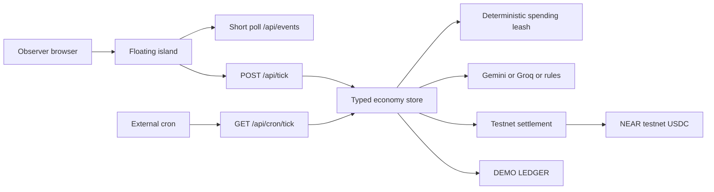

# Marketday

Marketday is a floating island market where five autonomous villagers farm, mill, bake, and trade. The village has a deterministic spending leash, a live event feed, free agent providers, and a clean observer mode.

The honest demo boundary is simple: real value movement is NEAR testnet USDC only. Pricing can show a free `INTENTS QUOTE (MAINNET DATA)` dry quote, which is pricing data only and never a settlement. When testnet credentials are absent, the whole village runs on a simulated `DEMO LEDGER`.


## What is real and what is simulated

| Surface | Real | Simulated or optional |
| --- | --- | --- |
| Wallets | Named NEAR testnet subaccounts under `marketday.testnet` | Demo wallet labels when setup is absent |
| Transfers | USDC transfers between seeded testnet agents, with transaction hashes and explorer links | Demo ledger balances and story state |
| Pricing | Free dry Intents quote labeled `INTENTS QUOTE (MAINNET DATA)` | Deterministic price fallback |
| Agent brain | Gemini, then Groq, then deterministic rules | Rule fallback when keys are absent or output is invalid |
| Login | GitHub OAuth when configured | Guest watch mode always works |
| Persistence | Supabase when configured | In memory local persistence |

## The 60 second demo

1. Open `/` and wait for the island HUD to show the current mode.
2. Open the scenarios dock and press `Run the story`.
3. Watch the baker run out of flour, compare offers, block the overcharge, and settle the fair offer.
4. Read the feed. Real settlements say `TESTNET TRANSFER` and include a testnet explorer link. Simulated events say `DEMO LEDGER` or `LOCAL RULE`.
5. Press `Trigger an overcharge` to show the deterministic leash.
6. Open `/status` for account balances, testnet links, LLM usage, and the environment checklist.
7. Open `/record` for a chrome free capture view.

## Quick start

```bash
npm install
npm run setup:env
npm run dev
```

Open `http://localhost:3000`. Guest watch mode and in memory persistence work without OAuth, Supabase, or an AI key.

To enable real testnet mode:

```bash
npx tsx scripts/make-account.ts --write-env
npm run seed:agents
npm run doctor
```

The seed command creates `baker.marketday.testnet`, `farmer.marketday.testnet`, `farmer2.marketday.testnet`, `miller.marketday.testnet`, and `merchant.marketday.testnet`. Agent keys remain server only in ignored `.near-agents.json` and `NEAR_AGENT_PRIVATE_KEYS_JSON`.

## Routes

`/` is the floating island and live feed. `/login` supports guest watch and optional GitHub login. `/market` shows bids, offers, and recent trades. `/leash` edits the local spending rules. `/status` shows mode, balances, links, LLM usage, and environment readiness. `/about` explains the real versus simulated boundary and roadmap. `/record` is a chrome free capture view.

## Architecture



## Free deployment

See [`docs/deploy-free.md`](docs/deploy-free.md) for exact faucet, AI Studio, Supabase, GitHub OAuth, Vercel, and cron-job.org steps.

## Development checks

```bash
npm run typecheck
npm run lint
npm test
npm run build
npm run check:secrets
```

## Roadmap after the hackathon

- Mainnet swaps with spending caps
- Bring your own agent
