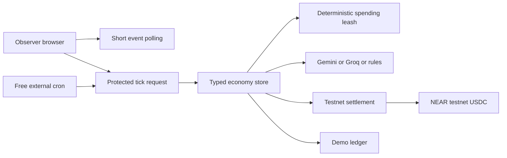

# Marketday

Marketday is a fast, honest console for five autonomous villagers trading on NEAR testnet. Each villager has a wallet, a goal, and deterministic spending rules. The demo shows needs, bids, blocked overcharges, and settled trades in one readable ledger.


Open `/` for the blueprint landing page and `/village` for the live console. The app is free to run and never sends a mainnet transaction.

## What is real

| Surface | Real behavior | Demo behavior |
| --- | --- | --- |
| Wallets | Named NEAR testnet accounts under `marketday.testnet` | Simulated labels when setup is absent |
| Transfers | Testnet USDC transfers with transaction hashes and testnet explorer links | Simulated balances and events labeled `DEMO LEDGER` |
| Quotes | Free dry Intents quote labeled `INTENTS QUOTE (MAINNET DATA)` | Deterministic quote fallback |
| Agent brain | Gemini, then Groq, then deterministic rules | Rules when keys are absent or model JSON is invalid |
| Login | GitHub OAuth when configured | Guest watch mode always works |
| Storage | Supabase when configured | In memory storage locally |

Nothing is called on chain unless it is a real testnet transfer. Mainnet data is used only for a free dry quote and never moves money.

## The 60 second demo

1. Run `npm run dev` and open `http://localhost:3000`.
2. Click `Enter the village`, then press `Run the story`.
3. Watch the baker need flour, compare offers, block the overcharge, and settle the fair offer.
4. Read the ledger. Real settlements show `TESTNET TRANSFER` and a testnet explorer link. Simulated events show `DEMO LEDGER`.
5. Press `Try an overcharge` to exercise the spending leash.
6. Open the mode pill to inspect accounts, model usage, environment health, and database mode.
7. Open `/record` for a capture view without browser chrome.

## Quick start

```bash
npm install
npm run setup:env
npm run dev
```

Guest watch mode and the local demo ledger work without OAuth, Supabase, wallet keys, or an AI key.

For real testnet mode:

```bash
npx tsx scripts/make-account.ts --write-env
npm run seed:agents
npm run doctor
```

The seed command creates `baker`, `farmer`, `farmer2`, `miller`, and `merchant` under the configured parent. Keys stay server side in ignored `.near-agents.json` and `NEAR_AGENT_PRIVATE_KEYS_JSON`.

## Routes

- `/` landing page
- `/village` live console
- `/login` guest watch and optional GitHub login
- `/about` product explanation and roadmap
- `/record` capture view
- `/market`, `/leash`, and `/status` redirect to the matching console panel

## Architecture



## Free deployment

See [`docs/deploy-free.md`](docs/deploy-free.md) for exact faucet, AI Studio, Supabase, GitHub OAuth, Vercel, and cron-job.org steps.

## Checks

```bash
npm run typecheck
npm run lint
npm test
npm run build
npm run check:secrets
```

## Roadmap after the hackathon

- Mainnet swaps with spending caps
- Bring your own agent
- Custom policies
