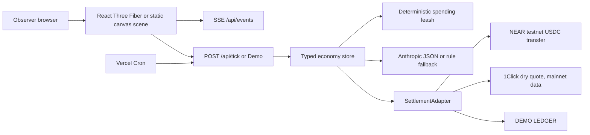

# Marketday

Marketday is a tiny animated village where every villager is an AI agent with a NEAR identity, wallet, needs, and deterministic spending rules. Agents farm, craft, get hungry, and trade in the market square. A visitor logs in socially and watches the village without ever seeing a wallet popup.

The demo goal is invisible infrastructure: the chain is real underneath, while the experience feels like a living little world. Agent decisions can use Anthropic when `ANTHROPIC_API_KEY` is configured, with a deterministic rules fallback. Spending rules are always plain code and never delegated to a model.

## Current implementation

- Stage 1: Next.js App Router + TypeScript + Tailwind foundations, environment contract, and NEAR capability notes.
- Stage 2: React Three Fiber floating island diorama with procedural buildings, trees, clouds, camera descent, and a day to night palette cycle.
- NEAR Intents settlement is represented by an explicit adapter boundary. On testnet, the UI labels this as `DEMO LEDGER` because Intents solvers are mainnet-only. The real adapter can be connected for mainnet without changing scene code.
- Stage 3 to 10: server-side NEAR adapters, 1Click dry quotes, agent ticks, SSE, spending leash, market animation, observer login, replayable story beat, Supabase persistence boundary, visual tour, record mode, and Vercel cron configuration.

## Architecture



## What is real

| Surface | With credentials | Without credentials |
| --- | --- | --- |
| Agent accounts | NEAR testnet subaccounts | DEMO LEDGER account IDs |
| Agent money | Testnet USDC transfer | In-memory balances |
| Pricing | 1Click `dry: true` quote, labeled mainnet data | Deterministic fallback |
| Swap settlement | Optional mainnet adapter, off by default | Never claimed as real |
| Social login | Google or GitHub through Auth.js | Guest watch mode |
| Persistence | Supabase REST snapshot | In-memory process state |

## Demo script

1. Open `/` and choose `ENABLE SOUND` after the page loads.
2. Press `D` or choose `DEMO [ D ]`.
3. Watch the baker run out of flour, three offers appear, the overcharge get blocked, and the fair offer settle.
4. Watch the baker produce bread and the merchant buy it.
5. Open `/record` for a clean capture view and `/about` for the judge summary.
6. Read the live feed labels. `TESTNET TRANSFER`, `INTENTS QUOTE (mainnet data)`, `MAINNET SWAP`, and `DEMO LEDGER` are never conflated.

The Vercel cron route calls one bounded tick every five minutes. Client ticks are useful for the live demo, while the cron route keeps deployed activity moving without a forever-running function.

## Run locally

```bash
npm install
cp .env.example .env.local
npm run dev
```

Then open `http://localhost:3000`.

## Hackathon window

Marketday is being built for the NEAR hackathon dev window of November 1 to 14, 2026. See [`docs/near-notes.md`](docs/near-notes.md) for verified capability notes and links.
